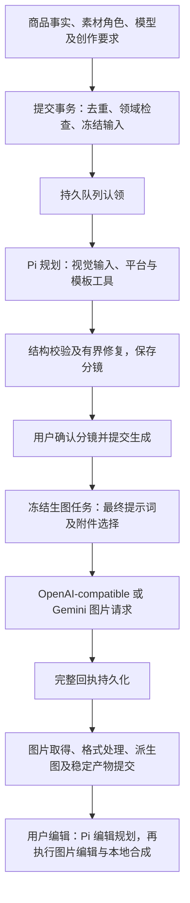

# AI 调用、上下文与流程编排审查及优化方案

审查日期：2026-11-09。基线：当前 0.4.8 工作树，Pi Agent Core / Pi AI 1.5.0。面向后续开发和维护人员。

**建议保留现有持久队列、冻结快照、请求账本与模板体系，优先修复请求正确性和上下文传递，再建立真实图片效果评测。** 目前的主要缺口是素材引用与最终附件缺少统一校验、部分约束依赖模型自行保留、编辑规划看不到参考图内容，以及失败回执与下载阶段的恢复能力有限。

本文是审查结果和待实施方案，不表示优化已经完成，也不改变当前需求或发布基线。需求、技术边界和交付状态分别见[需求文档](requirements.md)、[技术栈文档](technical-stack.md)、[项目当前进度](project-status.md)。

## 审查范围与证据口径

深查商品图片的提交与冻结、规划分批、最终生图、提示词修订和编辑流程，以及共用 Pi Runtime、Provider、调度和回执边界。辅助文案、模板工具、模型能力和共用图片适配器纳入审查；没有对模特、花型、分层等全部独立业务分支逐一验收。

结论分为：

- **代码确认**：能指出具体触发条件和实现路径；不代表真实用户已遇到该问题。
- **受控复现**：用合成输入或响应执行相关源码，证明当前行为；不代表真实模型质量验证。
- **设计限制／待评测**：实现边界已确认，但对图片效果的影响及优化收益需要真实样本比较。

本次未读取真实用户数据库、凭据或素材，未调用真实付费模型，未修改产品业务代码、依赖或数据库结构，未构建、打包或发布。

审查探针位于本机 [.cache/ai-call-audit-20261109/behavior-probes.test.ts](../.cache/ai-call-audit-20261109/behavior-probes.test.ts)，[最终报告](../.cache/ai-call-audit-20261109/behavior-results.json)为 **1 文件、6 项通过**。这些断言确认现有缺口仍然存在，不是修复后的验收，也不是应用全测。

首次运行被 Vitest 默认缓存目录排除规则挡住；调整独立审查配置后，首次实际执行的 3 个规划探针因依赖包 Mock 未命中而连接错误，另 3 项通过。[该轮报告](../.cache/ai-call-audit-20261109/behavior-results-mock-failed.json)保留。随后仅将审查脚本 Mock 移至源 Runtime 边界，并屏蔽外部 fetch，最终 6 项通过；未通过修改产品代码使探针通过。

## 当前实际调用链

| 环节 | 当前实际输入和行为 | 主要代码 |
| --- | --- | --- |
| 冻结 | 项目、素材记录、分镜、相关产物、Provider、模板、选中套图及 AI 参数进入有效输入快照；执行期读取冻结视图 | [snapshot.ts](../packages/backend/src/execution/snapshot.ts#L64)、[context.ts](../packages/backend/src/execution/context.ts#L125) |
| 商品规划 | 事实、禁用宣称、品牌、平台、市场、两类语言、创作要求和带角色的素材；支持视觉才附图片；按用途／SKU 分批，单批最多 12，整体最多 96 | [job-plan.ts](../packages/backend/src/execution/job-plan.ts#L24)、[product-image-planning.ts](../packages/backend/src/execution/product-image-planning.ts#L99) |
| Pi 推理 | 只读业务工具、按模型声明启用结构化输出；每轮设置输出上限和超时，关闭 SDK 自动重试；终态等待完整回执 | [runtime.ts](../packages/agent/src/runtime.ts#L48)、[stream.ts](../packages/agent/src/stream.ts#L11) |
| 最终生图 | 最终 promptInstruction，可选修订，再加实际附件的角色／句柄说明；发送原始素材字节，按模型门控部分尺寸、质量和格式参数 | [job-generation.ts](../packages/backend/src/execution/job-generation.ts#L27)、[visual-assets.ts](../packages/backend/src/execution/visual-assets.ts#L90) |
| 编辑规划 | 源图、用户修改要求、标注、选区是否存在、项目事实、分支记忆、参考图元数据和图片能力；参考图像素未附入规划 | [job-edit.ts](../packages/backend/src/execution/job-edit.ts#L73)、[planner.ts](../packages/agent/src/planner.ts#L233) |
| 编辑执行 | 源图与所选参考图的真实字节、必要蒙版；检查操作能力，进行硬蒙版／自然融合／扩图等本地处理 | [job-edit.ts](../packages/backend/src/execution/job-edit.ts#L147)、[edit-imaging.ts](../packages/backend/src/execution/edit-imaging.ts#L78) |
| 恢复 | 同键完整回执重放；已发送且无完整回执保留 UNKNOWN；用户直接重试或结束，稳定产物与运行代次防止重复和迟到覆盖 | [request-ledger.ts](../packages/backend/src/runtime/request-ledger.ts#L55)、[scheduler.ts](../packages/backend/src/runtime/scheduler.ts#L279) |

现有商品批次会严格检查跨批 campaignStyleLock 字符串一致，按 SKU 隔离商品真值；这两点已经实现。现有全局并发控制活动任务数；普通商品候选独立建任务，编辑的多个候选则在同一任务内顺序执行。两处帮写继续保持既有依赖顺序。

## 已确认的问题与边界

### A1. 提示词中的图片句柄可能无法对应实际附件——优先修复

**受控复现，影响主流程。** 规划校验把未知 referencedAssets 句柄静默丢弃，但没有验证最终提示词提到的句柄是否存在、是否选入同一条目的附件。[planner.ts](../packages/agent/src/planner.ts#L305) 的 SKU 分支额外检查其他规格的商品句柄，但未覆盖通用的引用一致性。

合成响应中 `referencedAssets=[P999]` 会变成空附件，而提示词仍保留 P999；另一个探针证明，提示词可提到存在但未选中的 R1。两种情况都直接通过，不进入修复轮。CREATIVE 普通生成可能因此失去商品图或引用不存在的构图参考；PIXEL_PROTECTED／SKU 的补图和真值检查提供部分保护，不能据此称所有路径都会缺商品图。

另有代码确认的边界：规划最多允许 4 张非商品参考，但手动修改引用时只校验项目归属，[storyboard.ts](../packages/backend/src/commands/storyboard.ts#L70) 未执行同样的数量和提示词一致性检查；实际选择会截到 4 张，[visual-assets.ts](../packages/backend/src/execution/visual-assets.ts#L44)。修订提示词后也没有重新验证句柄。

**建议：** 以实际附件清单作为唯一解析依据，在规划返回、手动修改和发送前校验句柄、数量、角色及 SKU 范围。检测应识别显式图片指代，避免把普通商品型号中的 P1 等误判为引用。合法完整回复中的模型错误进入有上限的修复轮；最终仍失配则在付费生图前给出明确错误，不能静默删除引用。

### A2. 扩图画布编码与 MIME／文件名错配——优先修复

**JPEG、WebP 两种源图均受控复现。** [createOutpaintCanvas](../packages/backend/src/execution/edit-imaging.ts#L19) 始终生成 PNG；[job-edit.ts](../packages/backend/src/execution/job-edit.ts#L160) 将其作为 inputImage 后，[同文件](../packages/backend/src/execution/job-edit.ts#L177) 仍由原产物路径推导附件 MIME 和文件名。严格校验内容的渠道可能拒收，也使请求来源记录不准确。

**建议：** 画布构造返回数据及真实格式元数据，源图、参考图和蒙版共用同一附件对象计算指纹、序列化与溯源。不能只修文件扩展名而保留错误 MIME。

### A3. 完整错误回执会在普通重试中重复重放——恢复能力缺口

**代码确认。** 非 2xx 的完整回执先持久保存，[request-evidence.ts](../packages/providers/src/request-evidence.ts#L80)；同键 COMPLETED 回执始终重放，[request-ledger.ts](../packages/backend/src/runtime/request-ledger.ts#L61)；一般领域重试只重置运行状态，不归档这类错误，[execution/index.ts](../packages/backend/src/execution/index.ts#L250)。因此临时 429 等响应完整到达后，同任务重试可能持续得到旧错误，没有新请求。

保留完整回执本身是有意的安全设计，现有[来源流水线测试](../packages/backend/test/commands/source-pipeline-retry-sol-20261106.test.ts#L48)还明确要求 HTTP400 的同任务重试不得再次 POST。应完善失败分类及用户重试语义，不能直接删除回执或给所有错误开启自动重试。

**建议：** 把回执完整性与业务结果分类分开。完整成功回执继续本地重放；本地解码／下载失败只恢复尾阶段；明确拒绝且按渠道协议可再次尝试的失败，在用户点击现有“重试”后归档旧失败并创建独立请求尝试。429 可作为优先分类对象，但 HTTP 状态码本身不能证明所有渠道均未执行；尤其不能把所有 5xx 一概视为未收费或未生成。保持 UNKNOWN 的直接重试／结束和历史计量，不增加核实表或费用确认。

### A4. 普通手动规划不校验请求顺序——范围有限的确定性缺陷

**受控复现。** [planner.ts](../packages/agent/src/planner.ts#L296) 只检查模板集合、数量及去重，随后按返回位置设置 sortOrder。普通手动规划请求“首图、细节图”，模型返回相反顺序仍被接受。

当前商品目标的 MANUAL 分支已按模板匹配重新排序，[job-plan.ts](../packages/backend/src/execution/job-plan.ts#L90)，因此该结论只适用于未走该纠正分支的普通手动规划，不应列为新商品主流程普遍排序错误。

**建议：** 由后端按冻结目标／请求身份绑定结果并排序；允许重复选择的流程使用明确 targetId，避免靠数组位置或模型自报顺序判断身份。

### A5. 图片适配器未统一验证返回字节——技术验证入口不一致

**适配器行为受控复现。** [openai-compatible.ts](../packages/providers/src/openai-compatible.ts#L240) 能将任意非空 base64 解码为字节，无法识别签名时标作 PNG；[Gemini](../packages/providers/src/gemini.ts#L57) 也主要检查是否存在图片字段。探针确认非图片字节可从适配器以 image/png 返回。

商品主生成随后会调用 [outputDerivatives](../packages/backend/src/execution/context.ts#L165) 解码并制作缩略图，因此这里**不等于损坏图片会被商品主流程登记为成功**。问题是统一接口的成功含义偏弱，各业务路径承担不同的后置验证，错误分类和处理时点不一致。

**建议：** 在共享图片接收边界验证非空、字节／像素上限、受支持格式、真实解码及真实尺寸；业务层再验证透明度、请求比例、蒙版和合成承诺。上游返回较小图片应记为输出未达要求，不能靠放大或转码冒充达到分辨率。可解码不代表商品一致或画面可用。

### A6. 商品描述输出固定中文标签——辅助文案缺陷

**代码确认。** [copywriter.ts](../packages/agent/src/copywriter.ts#L49) 传递 copyLanguage，但 [validateCopywriting](../packages/agent/src/copywriter.ts#L91) 始终加“产品名称／核心卖点”等中文标签。目标英文时，模型字段即使全英文，最终仍有中文标签。

**建议：** 按有效文案语言格式化标签或由结构化字段展示。该问题优先级低于图片请求正确性，但可与语言上下文规范一起修复。

## 对图片效果影响较大的设计改进

下列实现边界已确认；优化是否提高真实成图效果仍需评测。

| 编号 | 当前边界与证据 | 建议 |
| --- | --- | --- |
| B1 最终约束 | 规划要求把商品身份、禁用宣称、品牌、平台及风格写入 promptInstruction；[校验](../packages/agent/src/planner.ts#L372)主要检查非空、内部标签、模板及部分引用。生图阶段只取最终提示词并加附件角色；不会独立补齐全部事实／风格约束 | 将不可被改写覆盖的约束与镜头创作指令分开保存；最终由确定性编译器合并，生成和修订走同一入口。不能把提示词要求误当成模型已经遵循，也不能通过机械拼接保证所有语义正确 |
| B2 修订上下文 | [reviseGenerationPrompt](../packages/backend/src/execution/context.ts#L161) 只传旧提示词及修改要求；Pi 被要求保留约束，但没有原始事实、禁用宣称、品牌、镜头规格或实际附件清单可核对 | 修订只允许变更镜头创作部分，重新附加冻结硬约束并校验引用；记录变更范围。禁止把用户改背景的要求解释为允许改变商品结构或事实 |
| B3 编辑视觉 | [编辑规划](../packages/backend/src/execution/job-edit.ts#L78) 只看源图；参考图仅有名称、角色、用途等元数据，实际执行才附图；编辑执行也没有使用普通生图相同的附件角色前缀 | 规划附源图和实际选中参考图，并明确源图、参考图顺序及用途；执行时由同一清单编译角色说明。将禁用宣称、品牌、有效风格和原产物约束按任务需要传入，不能只依赖不断压缩的记忆 |
| B4 视觉预处理 | [context.ts](../packages/backend/src/execution/context.ts#L138) 超出条件的视觉图压到最长边 1024、JPEG80；这是给推理模型看的图，主生图仍发原始素材。不能据此声称最终素材已被压缩 | 保留总览，对细节、标签或明确选区按需补裁剪；材质、透明底等采用合适格式。缓存键包含源哈希、裁剪坐标及预处理版本。先比较识别与成本，避免全部图都改成最高分辨率 |
| B5 模板与选择 | [AI 模式](../packages/agent/src/planner.ts#L160) 主要提供模板 ID，完整规范依赖模型读工具；MANUAL 还会注入全部自定义模板。[工具](../packages/agent/src/tools.ts#L75) 一次可返回完整品类提示清单；素材选择按创建时间取前若干张 | 先提供精简用途目录，选型后注入所需模板、变体及匹配品类规范；只给当前选择的自定义模板。用户明确选择和 SKU 真值优先，参考图按用途及内容相关性预算；模型选型仍受白名单和模板校验约束 |
| B6 跨批编排 | 已锁定同一 campaignStyleLock，但后续批次不带之前镜头的完整意图摘要；单批角色去重不能保证全部批次不重复 | 在现有有界批次上加入全局镜头清单，记录目标、卖点、角度、构图及已覆盖任务；后续批次消费精简摘要。先用规则检查重复，再按需做语义比较，不默认额外增加一轮付费总规划 |
| B7 质量闭环 | 当前记录最终提示词、真实附件哈希、尺寸等技术证据，没有商品主流程的语义质量评分 | 先做技术检查，再按需评估商品身份、文字、SKU、主体完整和套图一致性；评分展示理由与证据，支持用户采用／重生成。评估模型的观察不能自动变为商品事实，质量评分也不能未经配置连续触发付费重画 |

建议的上下文结构为：**固定事实与约束 + 当前任务目标 + 可见附件清单 + 相关模板／平台规则 + 镜头创作指令 + 有界历史摘要**。每块记录来源与版本；未看到图片时明确标示仅有元数据，不能让规划器误以为已识别。

最终编译应保留商品身份和本地保护边界，先落实平台背景／文字等硬要求，再使用套图视觉方向和镜头创作。风格锁不能覆盖平台白底首图要求，也不能把套图色板强加为商品本身的颜色。需要冲突判断时使用结构化字段和明确优先级，不能靠不断追加互相矛盾的长提示词。

## 稳定性与调用效率优化

### C1. 能力从“协议默认支持”细化到模型及渠道

[imageEditCapabilitiesFor](../packages/providers/src/openai-compatible.ts#L279) 目前按 API 类型返回能力，OpenAI-compatible 默认支持全部编辑能力；实际渠道可能只实现其中一部分。现有高保真、质量、格式、尺寸已有部分模型门控，应复用并统一到能力配置。

建议以 `Provider + modelId + 协议版本` 维护有来源、可版本化的能力档案，描述图像参考数量／字节限制、蒙版、扩图、透明度、尺寸、质量、输入保真、结构输出和推理限额。区分协议可表达、模型声明支持及已验证支持。未知能力可沿用明确标识的兼容配置或保守门控，不能静默假定全部可用；不通过自动付费调用探测能力，也不能失败后偷偷换模型。

### C2. 超时按请求阶段定义，并与实际配置一致

已核对界面明确标为“推理请求超时”，[AiAdvancedSettings.tsx](../apps/desktop/src/renderer/features/settings/AiAdvancedSettings.tsx#L44)。因此图片没有读取该设置**不是当前界面承诺失效的缺陷**。

当前推理每轮默认 240 秒，OpenAI-compatible 图片默认 300 秒，Gemini 图片固定 120 秒，图片 URL 下载另有 120 秒。Gemini 适配器没有使用 connection.requestTimeoutMs。后续可为推理、图片生成和下载分别增加冻结的超时档案，避免用户误以为提高推理超时能延长生图。先观察各渠道耗时分布，再设默认值；大幅缩短超时可能增加 UNKNOWN。

### C3. 全局任务并发之外增加请求许可

现有并发是活动任务数，不等于 Provider 请求速率、GPU 生成容量或 Pi 工具轮数。建议保留全局任务并发，并按 Provider／模型增加最大在途请求数、速率窗口、429 冷却和 Retry-After 记录。

许可等待必须可取消，发生在账本登记发送之前；等待期间不能算作已发送或 UNKNOWN。资源许可、请求超时和工作流总预算分别计时。一个 Provider 冷却不能占满所有槽位并饿死其他 Provider 或本地任务。先做公平调度与指标，再决定是否需要自适应限速；不将调高全局并发视为图片质量优化。

### C4. 统一完整回复的结构修复与工作流预算

PLAN 对完整回复的解析／校验错误可修复一次；COPYWRITE 仅对过长结果压缩一次；EDIT_PLAN、PROMPT_REVISION 的处理不同。Pi 每轮有超时及输出上限，应用没有显式的整体工具轮数和总 token 预算；[模型档案](../packages/providers/src/reasoning-profile.ts#L34) 中 contextWindow／maxTokens 也采用统一值，不能代表所有渠道真实限额。

建议统一可解释的错误分类：完整但不符合结构、输出截断、能力拒绝、传输未知、本地尾阶段失败。完整回复的格式／枚举错误可使用已有上下文修复一次，修复请求独立记账并计入总预算。输出长度、批次大小和思考预算按模型档案及任务复杂度分配：描述帮写、轻微修订无需使用与 12 张分镜规划同样的额度。

整体预算在新一轮调用前检查，达到上限后停止新增调用并给出明确原因。不得为了硬凑总时限丢弃正在持久捕获的完整回执；发生传输未知时不能进入格式修复。SDK升级、Prompt版本和新请求格式会改变指纹，历史任务必须继续遵守原指纹检查，不能为“兼容”关闭它。

### C5. 将图片取得和本地提交作为可恢复阶段

[URL 返回分支](../packages/providers/src/openai-compatible.ts#L246) 的 JSON 回执已可靠保存，图片字节随后单独下载。短暂失败可以重新下载而无需重发付费生成；若 URL 已过期，仅有回执无法还原图片。

建议记录“模型回执已收、图片待取得、图片字节已持久保存、本地产物已提交”等内部阶段，下载后立即按稳定标识原子保存字节及哈希。恢复时先查字节缓存，随后才尝试可恢复下载；过期应如实分类。若渠道确实支持，优先请求可持久保存的内联图片结果，但仍需遵守回执体积上限。不能用重新 POST 偷偷补偿失效下载链接。

## 推荐实施顺序与交付标准

优先级表示本方案建议，尚未实施；不绑定未经确认的工期或版本号。

| 阶段 | 改动范围 | 交付标准与验证 |
| --- | --- | --- |
| 第一阶段：请求正确性与恢复 | A1、A2、A3、A5；A4、A6 可同批小修 | 发送前所有图片引用可解析，角色／SKU 一致；JPEG／WebP 扩图真实 MIME 正确；成功回执可重放，明确拒绝的显式重试可以按策略开启独立尝试，UNKNOWN 仍不自动重发；坏图片不会作为有效产物提交。覆盖真实本地 HTTP、断流、取消、重启和迟到结果，不只 Mock 返回对象 |
| 第二阶段：上下文与资源编排 | B1–B6、C1–C4；复用当前模板和 Pi | 固定约束和镜头指令分离，修订不会移除固定约束；编辑规划确实看见选中参考图；模板读取可追溯；预算／限流等待可取消且不制造 UNKNOWN；保留 SKU、白底主图、分支记忆和两处帮写依赖。用请求载荷、边界输入及实际 Electron 专项验证 |
| 第三阶段：恢复尾阶段与效果闭环 | C5、B7 和真实模型评测 | 已下载字节可跨中断恢复；URL 过期分类正确；技术合格与语义可用分别计量；真实评测记录模型、渠道、版本、成本和人工结果，明确哪些优化保留或撤回 |

第一阶段的 MIME 和引用修复通常不需要数据库改版。失败分类／新请求尝试需要审查 RuntimeStore、请求历史和用量 schema；确需新增持久字段时显式迁移，不用既有字段冒充新语义。第二阶段建议版本化 Context／Prompt 编译规则和能力档案；新任务使用新格式，历史快照和回执不做伪造升级。第三阶段若新增媒体接收记录或质量结果，应制定独立契约、保留策略和清理规则。

实际改动按范围执行检查；涉及队列、重试、取消、重启和 IPC 必须有真实行为测试。需要修改设置界面时构建并操作实际 Electron。根配置或锁文件变更按工作区规则全构建和测试；只做专项优化时不要自动重打安装包或重复历史全套验收。

## 效果与稳定性如何衡量

先建立固定样本和当前版本基线，再逐项改变因素。建议首轮选 20–30 个经过授权的代表性案例，覆盖白底首图、材质细节、小字标签、多 SKU、套图、中文／英文文字、带蒙版编辑和扩图；包含容易失败的长宽比、透明底、多个不同用途参考图。样本必须有可核对的商品真值和人工判定规则。

| 指标 | 记录方法与判定边界 |
| --- | --- |
| 引用正确率 | 所提句柄与实际附件、角色及 SKU 完全匹配；这是确定性检查，目标应为无失配 |
| 商品身份保持 | 人工盲评轮廓、颜色、材质、数量、标识及关键结构；视觉评估模型仅辅助并抽样校准 |
| 文案及事实正确 | 与明确要求的文字和已核实事实比较，结合 OCR 与人工；禁用宣称和未授权数字分别记录 |
| 镜头与套图可用性 | 角度／构图是否满足任务、镜头是否重复、风格是否一致，平台白底等要求单独判定 |
| 编辑遵循 | 修改目标是否完成；硬保护区按像素比较，自然融合边界按其实际语义评估；不能把所有模式都用逐像素标准判定 |
| 人工采用与返工 | 记录候选采用率、每个可用产物需要的生成次数及人工编辑次数；失败重试与主动换方案分开 |
| 稳定性 | 分开统计请求完整率、技术产物成功率、429／5xx、UNKNOWN、本地解码／下载／提交失败、恢复成功率和重复付费请求 |
| 时延与消耗 | 队列等待、许可等待、推理各轮、图片请求、下载和本地处理的 P50／P95；记录 token、调用次数及已知价格口径下的单位可用图成本 |

比较时固定相同输入、模型／渠道和分辨率，保留基线与优化提示词版本，随机化展示顺序并进行必要重复；模型不支持 seed 时记录随机性，不声称一张图证明提升。分别评估“补参考图”“按需细节裁剪”“约束编译”“模板精简”等因素，避免同时换模型、换 Prompt、加分辨率和并发后无法判断原因。

新增可观测信息复用已有 jobId、请求键、尝试代次、最终提示词和附件哈希，补充脱敏阶段、耗时、字节数、模板覆盖、结构修复次数和错误分类。模型回执、临时签名 URL 及可能含敏感内容的上下文仍按现有受保护边界存储；不在普通日志中复制凭据或整份用户上下文。

本次合成检查没有测得图片质量提升、实际限流容量、真实 Provider 可用性或单位图片成本。正式接受效果优化前，应先完成上述对照，并以结果选择默认参数，不能预先承诺提升百分比。
