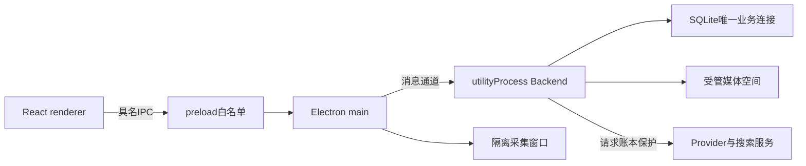

# 桌面架构与业务迁移

本文描述 **PixelMuse当前源码的桌面架构**，定位为“商品视觉创作工作台”。当前通信契约包含161项具名操作，其中新增7项套图蓝图、跨商品批次与规划转套图草稿操作；任务仍为20类，保留COPYWRITE内的Listing分支。九条业务路由与七类设置共用黑白应用壳，工作空间位置仅从设置页配置。已公开发布的0.5.0使用canonical v12，加入显式规划来源、批次关联和共享修订结果，保留AI高级设置及任务级中断处置约束。旧0.4.8为v11、0.4.6为v9、0.4.5为v7、0.4.4为v6，分别保留为历史与升级基线。本文相对代码路径以desktop根为准；源码验证与各版本冻结发布结果分别记录于[验证记录](../VALIDATION.md)，原实施过程见[历史入口](../MIGRATION_STATUS.md)。

依赖、来源、目录、设计与模块职责分别见[维护文档索引](README.md)。

## 进程所有权与通信

Electron main 管理窗口、系统文件对话框、剪贴板、safeStorage、资源协议与 Backend 生命周期。sandbox preload 只暴露固定白名单，React renderer 通过具名 TypeBox 操作调用**一个 utilityProcess Backend**。Backend 独占业务 SQLite、受管文件、Provider/搜索访问、嵌入式 Pi 和持久队列。生产程序没有 HTTP 业务服务、Redis、BullMQ 或 SSE 事件服务，不读取旧 `.env`、旧 Web 数据库或 `legacy/` 运行模块。Provider 的 SSE 响应是后台外部协议，与已移除的旧 Web 事件传输无关。

renderer 开启 sandbox/contextIsolation，禁用 Node、webview、外部导航、新窗口、权限及浏览器下载。生产 CSP 与请求白名单只允许本地页面和 `ecomgen-resource:`；renderer 不直接访问 Provider、数据库或任意文件路径。开发 Vite 服务仅供热更新，不是生产 Backend。preload 运行时仅导入 Electron，业务类型在编译期使用。

业务调用统一为 `invoke<K extends Operation>(operation, input): Promise<Output<K>>`。`packages/contracts` 是通信 schema 的唯一手写真相源，主进程与 Backend 均校验输入/输出；原生文件选择、剪贴板和生成文件保存的 schema 位于 `contracts/src/native.ts`，apps/shared 仅重导出。旧 operation 来源路径只用于离线 catalog/迁移核对，生产不解释 HTTP method/path。

查询结果是状态真相。变更事件仅带 topic/聚合身份/可选 revision，使 TanStack Query 重新查询；项目订阅按 projectId 筛选。RPC 超时不自动重发命令。公开错误使用安全摘要，不携带原始 Provider 响应、密钥或内部路径；公开 Output 的 `revision` 只从持久化 generationSnapshot 提取，完整快照仍为私有。

Backend 退出时先拒绝新命令，取消并等待已接受命令和执行器，随后清理、关闭连接、清空密钥并释放 owner。main 管理异常断开、拒绝在途 RPC 和有限重启；不能把取消信号发出当作执行已结束。

## 包与生产接线

| 模块 | 所有权与职责 |
| --- | --- |
| `apps/desktop` | Electron main/preload，PixelMuse 黑白 React 页面、CSS Modules、设计 token、AntD 深色中文主题、memory router，客户端画布与 PSD worker；隔离的商品浏览采集窗口。 |
| `packages/contracts` | 161项具名操作、公开DTO、变更事件、资源引用及固定原生能力；离线command-catalog另保留历史和退役来源，不全部作为运行操作。投影屏蔽私有执行数据。 |
| `packages/domain` | TypeBox领域模型、显式规划来源与套图蓝图、SKU/显式共图/用途与目标解析、容量、模型/分割能力、编辑、花型/草稿/Listing/印刷约束及外部请求端口。 |
| `packages/core` | canonical v12 DDL、桌面v1–v11显式升级、唯一连接上的聚合仓储、规划来源/批次关联/共享修订结果、SKU目录/采集来源/应用设置/用量/价格表、受管文件、SecretBox、目录及纯流水线服务；不启动网络或队列。 |
| `packages/backend/src/commands` | 原领域与设置处理器、商品规划和工作台采用/导出，以及7项套图蓝图/批次/规划转草稿操作；校验归属/CAS/能力，准备文件，原子创建意图与伴随行，冻结执行快照，返回公开投影。 |
| `packages/backend/src/runtime` | 7 个运行命令、RuntimeStore、资源引用/清理、逐请求账本、持久调度、恢复及只读历史投影。运行命令实现由 Backend business 模块组装。 |
| `packages/backend/src/execution` | 20 类实际任务、本地图像算法、快照视图、结果发布、领域结算、安全重试和后续步骤推进。 |
| `packages/providers` | 图片、分割、推理协议适配及逐请求 fetch 注入，不另建账本或状态库。 |
| `packages/agent` | Pi 规划、文案、编辑方案、元素识别、套图反推；受控模板/平台/套图/研究工具、结构化结果校验、取消及有界修复轮次。 |
| `packages/ecom-skill`、`ecom-suite`、`ecom-suite-forge` | 模板及提示编译、1173 套内置目录与用户套图、反推领域资源，保留上游来源。 |

`createBackend` 在一个 owner 下构造同一 SQLite 连接上的 EcomRepository、DesktopHistoryRepository、RuntimeStore、ResourceRegistry、RequestLedger 和 PersistentScheduler，使用同一 LocalAssetStore、SecretBox 与 SuiteCatalog。未传测试 integrations 时默认调用 `registerDomainCommands` 和 `registerExecutors`；显式测试替换不会悄悄补齐缺失命令，缺失操作报错。任务注册穷尽检查，未知类型没有默认导出或假成功分支。

## 界面与领域聚合

页面由 `main.tsx → app/App.tsx → app/routes.tsx` 加载，按路由懒加载，使用共用 AppShell 侧栏与上下文工具栏。侧栏导航在草稿工作区先等待保存屏障，失败则留在当前页面。九条路由为 `/`、`/projects/:projectId`、`/library`、`/suite-forge`、`/models`、`/patterns`、`/patterns/:patternId`、`/pattern-drafts`、`/pattern-drafts/:draftId`。

| 聚合/入口 | 关键持久化与交互 |
| --- | --- |
| 项目画廊、`SetupPanel`、`AssetsStage` | 项目 CRUD/归档/恢复、商品描述/事实/禁用宣称、平台/市场、独立提示词与文案语言、素材用途和模型配置。 |
| 设置中心 `/settings/:section` | 常规、模型配置（模型列表/服务连接/默认用途/高级设置）、用量、工作空间、搜索采集、软件更新、关于；保留全部协议/能力、模型发现与连接检查，Key 不回显。 |
| 规划、`StoryboardStage` / `StoryboardInspector` | 主图/SKU图/详情图用途分组、SKU草稿与显式共图及revision CAS；自主规划直接看商品／参考图，套图按镜头清单派生数量并按SKU展开。一个PLAN内部按不超过12画面分批、总计最多96画面后原子发布；ALL/STALE保留旧输出与无关编辑。每画面一份提示词，候选数仅控制本地独立调用，共享一次修订结果。明确旧模板来源仍精确校验，分镜版本确认与最近20份配置历史保留；首页批次组织独立项目任务，用户确认后才生图。详见[商品规划说明](product-image-planning.md)。 |
| `ResultsWorkspace` / `ReviewStage` | 多候选与批次、稳定 Output、审核/比较/选图、文案显式采纳、选图 ZIP、长图和切片。 |
| `EditImageWorkspace` | Session/Turn/Reference、父/根输出谱系、分支选择和逐输出记忆；PNG 编辑/保护蒙版、扩图、NEED_INPUT、人工方案确认与自动子任务。 |
| `LayersPanel` / `LayerStackDialog` | 自动识别方案、文本/框提示、SAM/Seedream 分层、PNG/PSD 历史；客户端显隐/排序、PNG/ZIP/PSD 编排导出，PSD 编码放 module worker。 |
| 套图工坊 | 独立来源图和 hints、反推历史草稿、schema 校验、编辑与显式确认入库；用户套图导入/编辑/分类与目录同步。 |
| 模特库、资产库 | 人物身份、参考脸内容版本、定妆候选与选定状态；跨聚合资产筛选/分页/去重、保存、复制到项目。 |
| 正式花型工作区 | 上传、SEGMENT/GENERATE 提取、主题起稿、确定性改色、生成式变体、验缝、印刷规格包、示意图、平台 Listing。 |
| 草稿工作台 | revision CAS 自动保存与离开前 flush；Media、Batch、Slot、Candidate、clientKey 冲突校验、父候选/笔迹、接缝编辑、去底/改色、比较及幂等定稿。 |
| 花型成包流水线 | SOURCE→TILE_CHECK→PRINT_PACK→LISTING 的持久步骤与 Job，接缝风险人工裁决、取消/重跑边界、成功后原子衔接。 |

Pi agent-core和pi-ai精确固定为1.5.0，随软件更新交付，不提供独立npm热更新。商品描述和补充说明帮写沿用单任务流程：活动PRODUCT_DESCRIPTION阻止PLANNING_INSTRUCTION，后端也检查该活动任务；提交后者前等待保存并保存未保存的描述，页面重新挂载不自动应用旧结果。

Pi 只嵌入这些业务工作流。工具读取受控领域文档或配置的搜索来源，不提供通用聊天代理、任意 shell 或任意本地文件工具。视觉研究保留来源审计，不能把搜索内容当成已验证商品事实。

## canonical SQLite v12 与历史保留

`packages/core`打开唯一业务连接，启用WAL、foreign_keys和busy timeout；当前源码与0.5.0的`user_version=12`。空库初始化、已发布桌面v1/v2转换和v3–v11升级均以IMMEDIATE事务提交DDL、数据转换和版本号。来源、应用设置、价格、最小化用量表按实际旧版本补齐；v5→v6将用量恢复游标纳入canonical DDL并保留有效64位游标；v6→v7新增项目SKU目录和分镜的用途快照/过期/替代标志，旧项目不编造SKU或历史归属；v7→v8增加项目工作台采用/详情顺序状态，使用独立revision保护整体保存；v8→v9替换UNKNOWN审计触发器；v9→v10加入任务级中断处置约束；v10→v11给已有应用设置补入AI默认值，保留旧任务快照和请求回执；v11→v12新增`storyboard_items.planning_source_json`、`desktop_suite_planning_batches`与`desktop_generation_prompts`，历史分镜不伪造新来源。升级和重开均校验schema身份及恢复表结构，已有游标表不能被重建覆盖；保留密文、任务快照、来源、输出与请求账本。用量表不随项目/任务级联删除。未知版本、无版本非空库或不符合结构的库拒绝打开。不加载旧Web数据库迁移链。

业务表覆盖项目/素材、Provider/搜索、模板/套图、分镜版本、Output/编辑、模特、正式花型/草稿、印刷包/Listing、流水线与导出。运行层只使用同连接的 `desktop_job_runtime`、`desktop_resources`、`desktop_cleanup_queue`，payload 由 runtime 版本化与 TypeBox 校验；没有第二份数据库、队列或资源账本。`backend.lock` 约束 owner，不能为抢锁终止已有应用。

桌面 v1/v2 一次性转换保留原 ID、Provider 密文字节、项目设置原文、素材文件引用、分镜版本原文、任务原快照/指纹/请求状态/结果。失效的已删 Provider 选择在当前配置中清空，历史原文保留。原平铺文件不移动、不复制；不导入 legacy 用户文件。

所有旧任务设为 `preserved_history=1`、不可执行/重试；未决外部窗口保守保留 UNKNOWN，明确 NOT_SENT 的旧外部运行任务可成为 CANCELLED 历史。数据库触发器防止重试、清除历史标记或改写历史输入/指纹。不使用旧载荷 decoder 继续任务，不制造新 Output/Pattern 冒充旧产物。

`getJob/listJobs` 提供可选 history 白名单：来源版本、原状态、`executable:false`、安全结果、带 available 的文件句柄。旧生成图片保留 ASSET 身份，旧 ZIP 用 EXPORT/jobId，旧 PSD 用 LAYER_PSD/jobId。资源按需校验登记，不启动扫描全部历史图片。ASSET 对照原哈希；旧 ZIP/PSD 校验现存容器后首次固定哈希，无法证明首次登记前的有效文件从未被替换。缺失/改变只使资源或投影不可用，原历史记录仍保留。

## 品牌、媒体工作空间与商品采集

显示名与安装器产品名为 PixelMuse，定位为“商品视觉创作工作台”。保留 `com.ecomgen.desktop` 安装身份、`@ecomgen/*` 内部包、`ecomgen:*` IPC 与 `ecomgen-resource:`，并在任何会话、锁和主密钥访问前固定原 `<appData>/EcomGen` userData。产品显示名不决定已有数据库和主密钥的新位置。

设置页的WorkspacePanel是唯一目录配置界面；AppShell只提供业务导航与设置入口，不持有工作空间弹窗状态。数据库 owner 与媒体 owner 分离。`MediaWorkspace` 在原 dataDir 保存工作空间身份、配置和版本化迁移日志，媒体根缺配置时仍使用原 dataDir。用户选定父目录后在专用 `PixelMuse/` 子目录复制受管命名空间和历史引用。迁移前维护屏障暂停调度认领、拒绝新业务操作，并等待已接受命令、查询写入与资源清理退出；有活动/排队任务时拒绝切换，不取消付费任务。逐文件流式复制和 SHA-256 校验完成后才原子提交配置，再由 main 正常关闭并重建 Backend。源文件保留，复制中断/取消/失败不切换活动根，提交后的失联不静默回退。

媒体根拥有独立所有权与身份标记。权威 claim 置于父目录，按规范目标路径分组并包含 PID 与随机身份，死进程回收只删除永不复用的唯一文件；清理目录本身不会擦掉仍需持有的所有权。迁移在发布前分别预占 staging 与最终目录；提交前并发核验当前源、目标内容，在临时配置 fsync 后以同步元数据与身份屏障收尾，不把这种文件系统复核称为操作系统原子快照。每次存储寻址核验目录，防止设备失联后创建空白替身。画布生成文件先通过有界宿主契约归档到受管 exports，再提供原生另存副本。原生 `workspace()` 只接收操作和空输入，目录来自 main 的系统选择器；绝对目录只通过专用原生只读显示契约返回，不放宽普通业务 DTO 的路径边界。

`collection()` 只能由工作台可信顶层 frame 调用。远程商品页位于独立非持久 session，启用 sandbox/contextIsolation，关闭 Node/webview、应用 preload、权限与普通下载，弹窗继承同样的隔离规则。用户主动读取时运行固定隔离 world 提取器，候选绑定采集身份与页面 revision；renderer 只得到候选身份、尺寸和本地解码预览，不加载任意远端图片地址。

采集会话通过只监听 `127.0.0.1`、带随机认证的临时转发代理，使 HTTP 请求和 HTTPS CONNECT 的实际连接固定到经校验的地址；移除隐式 loopback 绕过，没有 DIRECT 回退，并禁用非代理 WebRTC UDP。HTTPS 仍由 Chromium 端到端验证证书，代理不解密 TLS。该通道不提供业务 API，业务通信继续使用 IPC。

宿主图片下载独立校验 HTTP(S) 目标并固定 DNS 连接，每次重定向重新验证，限制跳数、并发、字节、耗时及 Cookie。Cookie 按准确目标 URL 从当前会话取得，再以 PSL、私有后缀、协议和尾点域区分同站上下文；Referer 按每跳目标采用保守策略，来源持久化和请求头使用不同的完整 URL 长度界限，不切断序列化 URL。签名图片地址、认证路径参数与浏览凭据不持久化。主窗口与子窗口按当前活跃远程页面选择来源，焦点/导航改变使旧候选失效。测试只能在受控 Node inspector 内对真实已打包策略注入一个明确的 loopback fixture 例外，正式入口没有环境变量放行开关。

Backend通过明确的host操作执行图片检查、预览和导入，与当前161项普通具名操作分别校验。导入最终事务同时发布资产、资源登记与来源，固定 `STYLE_REFERENCE`，重复内容不改变既有角色、不覆盖来源，不写商品真值或已核验事实。来源 URL 去除认证/跟踪参数，图片地址和浏览凭据不进入来源表。关闭、跳转与刷新取消尚未发布的导入；已经提交的结果始终以项目和来源查询为准。

## 应用设置与用量

应用设置由 Backend 在同一 SQLite 连接持久化，严格校验模型用途、分割协议、界面缩放和可恢复业务路由。AI高级设置包含推理超时30–1800秒（默认240）、思考强度auto/off/low/medium/high（默认auto）、最大输出Token 512–65536（默认16384）和全局并发1–16（默认2）。新任务冻结推理参数；旧快照缺少这些字段时继续使用原默认行为。自动思考对文案用low、其他工作流用medium，不支持思考的模型关闭思考。探测使用独立轻量配置，搜索保留独立超时。全局默认不回写已有项目或冻结任务；删除连接或修改能力时，在同一事务清理失效默认。设置和统计仅访问数据库，媒体失联或迁移期间仍可使用，原有受管媒体屏障继续生效。主进程原生 `application()` 提供版本信息、固定数据/日志目录、白名单诊断和有界 UTF-8 CSV 保存，不能接收任意目录或文件类型。

请求用量以 `(jobId,requestKey)` 唯一存储，首次登记固定名称与价格快照；回执重放与本地提交不重复计量。只有完整加密回执保存后才提取已知 JSON/SSE 协议的计量字段，无法识别、缺失或不安全数值保持未知。缓存输入计价避免与普通输入重复累计，费用按币种与已计价覆盖数展示，不能称为账户账单。完整响应、HTTP成功、本地产物提交是不同状态。

历史回填只在 Backend 连接初始化阶段做有数量和字节上限的读取，普通统计查询不解密全库回执；界面说明历史缺口。公开统计与 CSV 只包含安全计量字段及名称快照，不输出 Prompt、headers、响应体或凭据。完整回执落库后的统计失败不能触发网络重发或阻断本地回放；恢复覆盖以实际有界回填为限。

## 命令事务、执行快照与去重

命令在同一同步事务内创建 Job 以及 Turn、Batch/Slot、Pipeline/Step、Export、LayerPlan/Export、PrintPack 等关联，再 `freeze` 完整执行快照。成功提交后才唤醒调度。文件/网络 I/O 在事务之外，禁止跨 await 持有 SQLite 事务或传入异步结算回调。变更通知也在成功提交后发送，回滚不发假通知。

冻结结构保存版本、jobId/type、原业务input、effective与资源`{ref,hash}`。effective包含实际项目/事实、模型/能力/协议、加密凭据、模板/套图、素材身份与哈希、参数、编辑/草稿祖先和算法依赖。新任务仅冻结明确引用的套图完整定义；SUITE_FORGE保留ID碰撞校验所需目录，原持久快照不改写。执行只读该快照，不在认领时改用当前Provider或新项目配置。实时仓储读取仅用于取消、归属、CAS、已完成产物和发布校验。RuntimeStore按schema身份复用编译校验程序，每次仍查询、解析并校验真实持久数据，不缓存任务或校验结果。

**不可变快照与可变运行账本分离。** 请求/phase/attempt/runToken 更新不能改原始输入。生成指纹按实际提示意图、素材身份/哈希/角色、有效模型配置、候选序号与生成参数计算，排除 status、updatedAt、compiledPrompt 等执行会修改的字段；自动 generationBatchId 也不制造新意图。`revision='retry'` 只是特殊重试元数据，归一化为缺省，不触发提示词修订或生成新指纹。真实修订内容或参数变化才按对应业务规则形成新意图。

同指纹任务复用，增加候选只创建缺少的序号。草稿另以 clientKey/槽位身份校验，流水线以步骤意图约束。不得通过改请求键、特殊重试标记、清空槽位 Job 或重置流水线，绕过相同 UNKNOWN。普通 RPC 超时也不解除已提交意图。

## 持久队列、部分成功与 fencing

PersistentScheduler 直接扫描 SQLite 中已冻结 READY 的任务，全局并发默认2，可在设置中调整为1–16；变更影响后续认领，降低上限不会取消已运行任务；enqueue 只安排扫描，不另建内存状态真相。认领事务递增 attempt、生成 runToken，公开 Job 状态为 RUNNING。执行输入深度冻结，开始前解析所有资源并核对哈希。

执行器的 `checkpoint` 在事务内重新检查 RUNNING、attempt、runToken、取消意图和领域归属。Output、草稿候选/槽位、分层文件、资源引用等只在当前代次发布。稳定 generationKey、candidate/slot/element 身份决定产物，不能按已有数量推算下一序号；迟到旧任务不能写入当前分支或推进替换后的步骤。

文件先有界写入独占临时文件并原子发布，再在同步事务内提交领域行、资源登记与相应成功状态。多候选可分段 checkpoint，因此部分成功在整体失败、取消或 UNKNOWN 后继续保留。最后任务终态与领域 settle 同事务提交；流水线下一 Job、快照和编辑自动子任务也由同步 settle 原子衔接。不是把全部文件系统操作假称为 SQLite 原子事务。

终态按逐请求账本裁决，未决外部结果优先于取消/普通失败。关联 Layer、PrintPack、Export、草稿槽位、编辑回合和流水线同步变化，已成功产物不被覆盖。接缝风险停在 `AWAITING_INPUT / SEAM_RISK`；外部未知阻塞使用 `EXTERNAL_RESULT_UNKNOWN`。

恢复使用已版本化的执行快照与逐请求账本：未发出请求的中断任务可重新 READY，保留取消意图；独立任务的完整回执可供禁止新增模型请求的本地尾阶段重放。编辑、流水线等成功结算可能创建付费后续任务的流程，在重启时保留回执并转为需明确继续的失败状态。IN_FLIGHT 在终结和重启时收敛为 UNKNOWN，显示为可直接重试或结束的中断任务；旧执行代次的迟到回执仍被 fencing 拒绝。损坏/缺失的执行证据不能伪装成安全重试，原 JSON 留存。只读 v1/v2 历史始终排除在认领与恢复之外。

## 逐请求回执与外部窗口

每个模型轮次、候选、元素及搜索调用使用稳定 RequestDescriptor：requestKey、fingerprint、purpose、可选 Provider/model 身份。Provider 适配器与 Pi SDK 注入同一 ExternalRequestScope 的 fetch；不使用第二份 attempt 台账、全局 fetch 拦截或环境变量桥。

1. 业务事务提交后，在真正发送前独立持久化 IN_FLIGHT。外层事务尚未提交时 begin/fetch 拒绝执行，SAVEPOINT 不被误当成持久提交。
2. 每个稳定请求只发送一次；自动网络重试关闭，不能依据兼容端点的幂等头假定服务会去重。付费适配器拒绝自动跟随可能重发 POST 的重定向。
3. JSON/图片响应在完整读取后，以 SecretBox 加密保存 status/headers/body 与响应哈希，再交给业务解码或下载。每份回执有容量上限，签名 URL、响应头和服务任务身份不进入公开 DTO。
4. SSE 可以在 IN_FLIGHT 时实时提供 token/分镜观察进度。捕获持续到 EOF，核验终态帧并持久化完整回执；每次 fetch 有独立 settled 屏障。Agent 的成功返回、工具执行和下一付费轮次均等待该屏障，早到的 SDK 终态不能代替完整回执。
5. 完整回执状态 COMPLETED 与本地产物 localState=COMMITTED 分开。后者只在领域提交事务内设置。已完成请求重放原回执，不重新 POST；CDN 下载属于尾阶段。
6. 发出请求后中断且无完整回执，记 UNKNOWN，不自动重新发送。`resolveJobInterruptions`接收任务或项目范围的RETRY/END直接操作，不需要额外风险确认；后台按任务整体归档未完成请求并保存interruptions记录（动作、时间、代次与原请求身份），UNKNOWN事实保持不变。RETRY使用原冻结输入和可靠回执继续，END只结束本地任务并同步关联状态，不发送请求。批量操作报告逐任务结果，保留项目范围、活动执行器、只读历史、槽位和流水线代次等检查。新请求独立计量，旧无回执用量仍为UNKNOWN，不补造Token或费用；旧核实审计只作为历史保留。

可靠完整回执的本地恢复仅支持独立 PLAN、COPYWRITE、GENERATE、SUITE_FORGE、MODEL_CAST，拒绝 pipeline；只重放已有回执，不新增模型请求。缺少后续所需回执时失败并保留数据。其他 FAILED/CANCELLED 重试仍须通过领域关联与账本检查，不能把本地恢复解释为远端未知调用可重试。

公开 `getJobRequests` 只有 requestKey/state/localState，不包含回执内容、凭据或可供 renderer 使用的远端任务密钥。

## 20 类任务与 Listing 分支

| 任务族 | 实际执行 |
| --- | --- |
| PLAN、COPYWRITE | Pi 规划/研究审计、分镜与配置历史；商品描述/规划指令单独保存并由用户采纳。COPYWRITE 的 LISTING 分支生成花型平台文案，可无项目。 |
| GENERATE、EXPORT | 稳定候选 Output、真值与参考、尺寸/比例/格式；流式 ZIP/manifest、选图、详情长图和切片。 |
| EDIT_PLAN、EDIT_GENERATE | NEED_INPUT/确认/自动子任务，引用与分支记忆、蒙版/保护/自然融合/扩图，多候选输出谱系。 |
| LAYER_PLAN、LAYER_EXPORT | 视觉元素识别、中英文分割提示，SAM 文本/框提示或 Seedream、源像素元素、PNG/PSD。 |
| SUITE_FORGE、MODEL_CAST | 多来源套图反推草稿与实时观察进度；人物规格/参考脸和定妆候选。 |
| PATTERN_EXTRACT、PATTERN_FORGE、PATTERN_DERIVE、PATTERN_VARIANT、PATTERN_TILE_CHECK | 分割/生成式提取、主题起稿、本地改色、生成式画风/构图变体、确定性验缝证据。 |
| PRINT_PACK | 尺寸/DPI、居中/满印、重复排列/原生重复单元、品类示意图和 manifest。 |
| PATTERN_DRAFT_GENERATE、PATTERN_DRAFT_EDIT、PATTERN_DRAFT_CUTOUT、PATTERN_DRAFT_PROCESS | 稳定槽位起稿、整图/笔迹/接缝改稿、SAM 去底、本地改色或验缝，显式定稿另由命令入库。 |

## 真值、源像素与图像边界

CREATIVE 的普通规划/生成可无商品图，不能统一施加“所有任务都必须真值”的限制。PIXEL_PROTECTED 要求当前项目实际 PRODUCT_TRUTH 及支持图片参考的模板；普通生成下发真实商品图与保真约束，远端模型仍无逐像素保证。商品文案和视觉识别另有自身的商品图/视觉能力要求。

源像素保证仅适用于实际本地算法：SAM 分割提取、草稿去底、SAM/Seedream 元素层以源 RGB 和 `sourceAlpha × mask` 产生 PNG。Seedream 返回的元素图只用于选区，补绘背景为生成内容，仍保留源 alpha；挖空背景与软边叠加不能承诺完整复原源画面。人工画框与提示词选择属于用户输入，自动识别则是独立视觉模型方案。

编辑的 MASK_LOCKED 本地合成保留有效选区外 RGBA（包括透明像素隐藏 RGB），保护蒙版扣除可编辑区；NATURAL_BLEND 允许过渡带变化。OUTPAINT 按几何位置回贴原 RGBA，透明原区域也不透入生成底图。MODEL_DIRECTED 直接采用远端结果不具备这些本地保证。蒙版尺寸不匹配拒绝，不静默缩放；负数/非整数或超像素扩图拒绝。

花型改色、验缝、印刷排版、详情长图是本地确定性处理，但改色/缩放当然会改变像素。印刷放大使用重采样，不能叫无损放大；Listing 不执行平台发布。背景能力/透明底承诺必须核验，未兑现保留已付费产物并报告，不能伪造透明成功。

## 资源身份、导入与清理

renderer 只持有 `ResourceRef {kind,id,index?}` 或 ResourceHandle；`ecomgen-resource://KIND/id[/index]` 编码业务身份，不编码私有路径。Backend 的公开查询不含 storagePath，main 验证可信主 frame 后使用私有 `host.resolveResource` 获得受管路径。预览只读该资源协议；保存已有资源先解析、显示原生对话框，再重新解析并核对哈希，renderer 无保存路径权限。

资源登记与发布领域行同事务，ref 不能改绑新路径/哈希。owners 同时保留聚合、任务快照及历史引用；MODEL_FACE 使用模特身份加内容哈希，替换参考脸不改旧任务引用。缩略图登记其实际 WebP 字节哈希，不能冒用原图哈希。

删除先取消并等待活动任务，释放明确 owner，记录持久 cleanup 意图。仍被其他聚合/任务/历史引用的文件拒绝回收；RETIRING 期间不能新增别名绕过。路径按段、realpath 和 Windows 大小写/分隔符别名校验，拒绝链接、硬链接、设备名、替代流和穿越。不能扫描目录猜测旧平铺文件归属并删除。清理在开始接受命令前、以及关闭且命令/执行全部退出后进行，失败意图可重入。

容量按入口区分：

| 边界 | 当前源码口径 |
| --- | --- |
| 输入图片 | PNG/JPEG/WebP/AVIF/TIFF；规范 Base64、真实文件头和 MIME 一致性，业务入口继续调用完整解码验证；编辑/保护蒙版单独限定 PNG。 |
| 普通上传、反推 UI | Backend 普通图片入口及 renderer File 转字节限 50 MiB；套图反推 UI 引用领域上限 30 MiB，最多 12 张来源图、目标 5–12 镜，不能写成所有入口都支持 50 MiB。 |
| ByteImport 与图片检查 | 64 MiB 是单份传输容量；LocalAssetStore 默认图片 64 MiB、100,000,000 解码像素。Sharp 先检查字节/像素，再用 animated+stats 遍历全部页面，不仅看 metadata，也不返回无界 raw 缓冲；原生解码取消须等待有界工作结束。 |
| 图片计数 | 项目商品图 6、其他参考合计 6；规划/文案使用此选择。普通生图非商品参考最多 4，商品图单独计数。草稿参考 6、笔迹另限 24。 |
| 候选与元素 | 分镜/编辑/选角/花型起稿/变体/草稿候选各1–4；原AI规划单次1–12镜，新商品规划最多96画面、单批不超过12；SKU/共图组各最多60，主图0–12、详情0–24、每SKU组1–4画面；fal/Grounded-SAM/Gitee元素上限32、Seedream16，Gitee无框提示。 |
| 原生选图 | maxFiles 1–32，默认单选 1/多选 32，单图 50 MiB、本次合计 128 MiB；不是所有拖入/粘贴入口的统一批量限制。 |
| 原生剪贴板、客户端生成文件 | 文本 schema 为 65,536 字符（现文案称 64 KiB）；saveGeneratedFile 64 MiB，校验 PNG/PSD/ZIP/JSON 签名及扩展名。适用于画布、客户端图层编排和模板等实际调用入口，不等同于 saveArtifact 的已有资源复制。 |
| 存储默认尾阶段 | 缓冲读写最多 256 MiB、流式导出最多 2 GiB；具体图像算法/业务还有自身画布与尺寸限制，不能用存储上限覆盖更严格入口。 |

## 密钥、备份与离线资源

main 生成随机 32 字节主密钥，由系统 safeStorage 封装在 userData/master-key.enc，经父子 IPC 交付 Backend，不通过 argv、环境变量或日志传输。SecretBox 使用 AES-256-GCM、每次独立随机 IV；Provider/搜索密钥和完整外部回执加密保存。公开 DTO 只返回 hasApiKey 等状态，不回传密钥、密文、回执或完整执行快照。

userData 包含主密钥封装、日志和data/backend.sqlite；未配置独立工作空间时媒体也在其data目录，配置后媒体位于独立根。运行中SQLite可有WAL/SHM。备份应退出应用，同时复制完整userData和当前独立媒体工作空间，不能只备份业务库。safeStorage 绑定系统账户/设备环境，整目录复制不保证跨环境解密，当前无可移植密钥导出。`ECOMGEN_DESKTOP_DATA_DIR` 仅覆盖隔离运行的整个 userData，不是读取旧环境文件的兼容入口。

内置套图 SQLite 在构建期由受控源码生成，与用户业务库分离；打包到 asar 外供原生 SQLite 只读访问。生产 CSS 的字体只用本机 `local()` 和系统回退，仓库没有字体二进制，不发在线字体请求；fonts/README 中的子集字体计划不能当作已随包交付。自有许可证清理仅涉及已授权的 7 份文件及自有 MIT 元数据，第三方依赖/Electron 声明和上游来源保留。

## 验证与发布边界

开发环境要求Windows x64、Node>=22.19.0、pnpm11.19.0，Electron固定45.2.3。在desktop实际cwd运行命令，全测推荐maxWorkers=1并与Electron/打包分开执行。当前命令与新增功能步骤见[维护流程](maintenance.md)，用户构建/运行说明见[应用README](../README.md)。

0.3.0历史基线曾通过111文件/996项与Source/EXE完整64场景；0.4.0冻结版本通过136文件/1450项与Source/EXE各64+14+5场景。它们不是0.4.1维护改动的验证结果，当前结果单独记录。完整业务门槛仍覆盖131原操作、29业务族、20类任务与Listing，并要求错误和清理检查通过。模型新建先取消旧列表响应再重查，避免首次请求覆盖新记录；资源清理仅在单批内复用路径比较键，引用/意图实时重读，实际文件删除仍重新执行受管路径检查，防止累积清理耗尽启动/关闭时限。完整门槛保持不变，局部检查和仅启动不能替代它。

测试只使用隔离目录、生成图片、真实本地数据库/图像/ZIP/PSD/Pi 及本机假 Provider，不代表真实模型的质量、计费、远端能力或去重实现已验证。系统文件选择器测试注入选中值与真实 Windows 对话框 UI 验收也是不同范围。

`pnpm run pack` 和 `pnpm run dist` 分别先构建再生成解包程序或 NSIS x64 安装器；`pnpm pack` 是 tarball。发布产物按release/<version>分类保留；已发布0.4.5位于release/0.4.5，0.4.6维护版本已生成独立安装包，实际专项与产物检查见验证记录，不覆盖已有升级基线与冻结包。静态、实际EXE和安装器payload结果分别记录，不把旧版本文件数量作为新版本断言。原生模块、sharp 和 builtin-suites.db 解压到 asar 外。安装/已安装路径运行/升级/卸载尚未验收。发布检查器要求报告路径尚不存在且位于发布目录之外，静态通过不能代替实际 EXE 运行。

维护时以当前源码、[维护状态](../MIGRATION_STATUS.md)和[验证记录](../VALIDATION.md)共同判断；对专项维护如实列出实际范围，不把历史全量通过套用到新源码。
